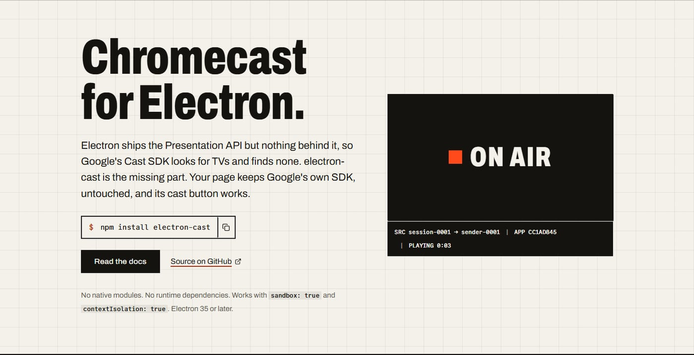
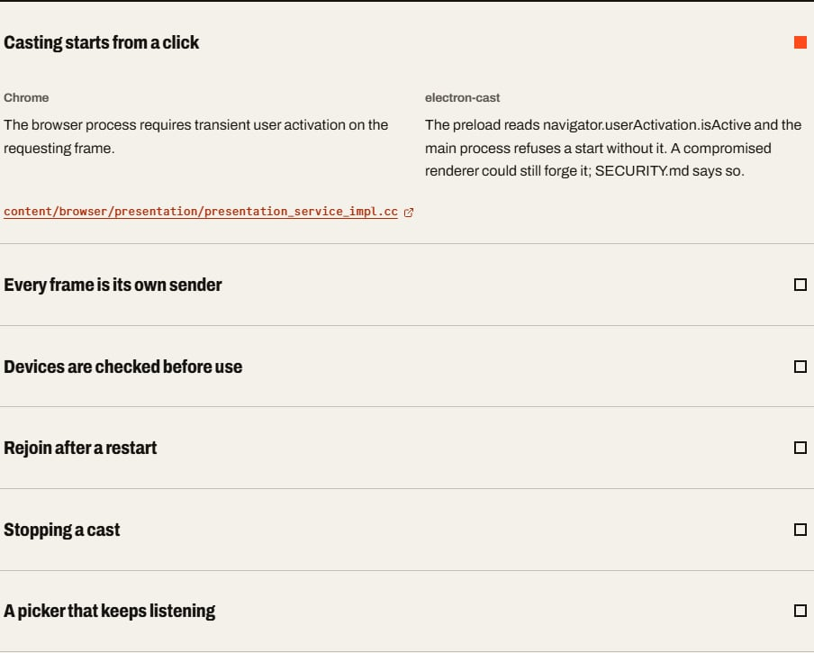
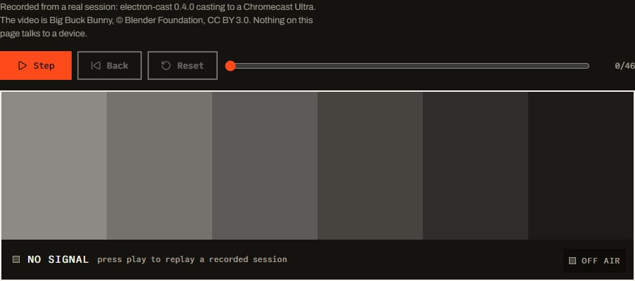
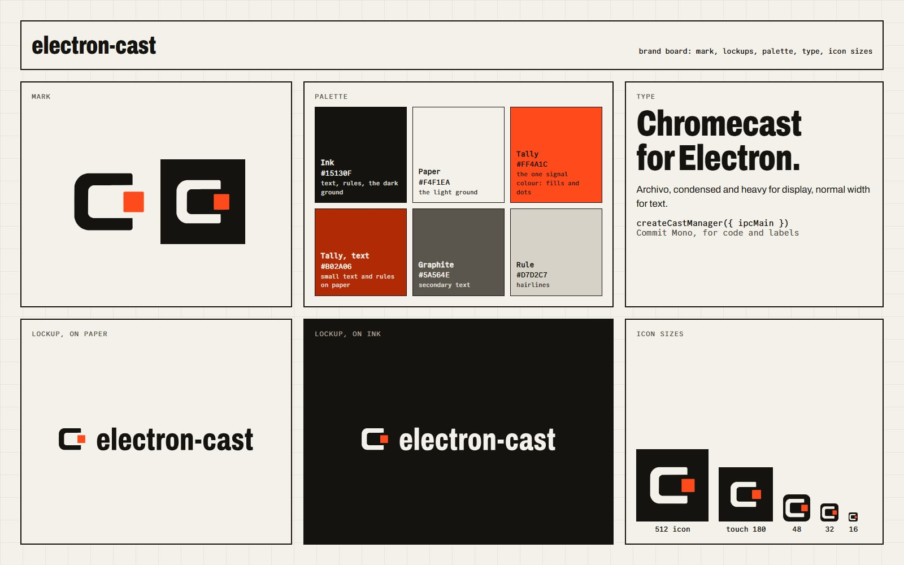

<div align="center">
  <a href="https://adammpkins.github.io/electron-cast/">
    <picture>
      <source media="(prefers-color-scheme: dark)" srcset="docs/readme/hero-dark.jpg">
      
    </picture>
  </a>
</div>

# electron-cast

<p>
  =20">
  =35">
  
  
  <a href="https://github.com/adammpkins/electron-cast/actions/workflows/ci.yml"></a>
</p>

**Google's own Cast SDK, running unchanged in your Electron app.** Docs: [adammpkins.github.io/electron-cast](https://adammpkins.github.io/electron-cast/).

Chrome's Cast support for Electron: pages run Google's own, unmodified Cast SDK, and your main process supplies the
Media Router that Electron lacks.

Electron has the Presentation API but nothing behind it, and electron/electron#869 (a Media Router for Electron) was
closed in 2025 with no plans to add one. electron-cast fills that gap from scratch: a stand-in Presentation API in the
page, and in the main process mDNS discovery, a device picker hook, the Cast v2 channel, device authentication with
Chrome's certificate checks, and the message envelope Chrome's Media Router speaks to the SDK. A site's own cast
button (YouTube Music's, for example) works unchanged. No native modules, no runtime dependencies, and it works with
`sandbox: true` and `contextIsolation: true`.

```sh
npm install electron-cast
```

- [Getting started](docs/GETTING-STARTED.md): from zero to casting, with packaging notes for each OS.
- [Guides](docs/guides/index.md): a device picker, restart rejoin, iframes, custom receivers, testing.
- [API reference](docs/API.md), [main-process API](docs/MAIN-API.md), [architecture](docs/ARCHITECTURE.md),
  [troubleshooting](docs/TROUBLESHOOTING.md), [FAQ](docs/FAQ.md), [security](SECURITY.md), [changelog](CHANGELOG.md).

## Quick start

Four small pieces. Needs Electron 35 or later and Node 20 or later.

**1. Main process.** Create one manager, say which pages may cast, and show a picker when the page asks:

```ts
import { app, ipcMain, Menu } from "electron";
import { createCastManager } from "electron-cast/main";

const cast = createCastManager({
  ipcMain,
  // Only these pages may cast.
  allowOrigin: (origin) => origin === "https://music.youtube.com",
  // Called when the page asks to start a session. Resolve a device, or null to cancel.
  selectDevice: (devices) =>
    new Promise((resolve) => {
      let picked = false;
      Menu.buildFromTemplate(
        devices.map((d) => ({ label: d.name, sublabel: d.model, click: () => ((picked = true), resolve(d)) })),
      ).popup({ callback: () => setTimeout(() => picked || resolve(null), 100) });
    }),
});

// Not a top-level `await app.whenReady()`: see the Electron 45 note in docs/TROUBLESHOOTING.md.
app.whenReady().then(async () => {
  await cast.start();
  // create your windows here
});
app.on("will-quit", () => void cast.dispose());
```

**2. Preload** of the window or view that shows the page:

```ts
import { contextBridge, ipcRenderer } from "electron";
import { installCastBridge } from "electron-cast/preload";

installCastBridge({ contextBridge, ipcRenderer });
```

A sandboxed preload cannot load other files, so bundle it (esbuild, for example). Import from `electron-cast/preload`,
not the package root, which needs Node's `tls` and `dgram`. Why and how: [Getting started](docs/GETTING-STARTED.md#2-the-preload).

**3. The page** loads Google's Cast SDK as it would in Chrome. Nothing electron-cast specific:

```html
<google-cast-launcher></google-cast-launcher>
<script>
  window.__onGCastApiAvailable = (available) => {
    if (!available) return;
    cast.framework.CastContext.getInstance().setOptions({
      receiverApplicationId: chrome.cast.media.DEFAULT_MEDIA_RECEIVER_APP_ID,
      autoJoinPolicy: chrome.cast.AutoJoinPolicy.ORIGIN_SCOPED,
    });
  };
</script>
<script src="https://www.gstatic.com/cv/js/sender/v1/cast_sender.js?loadCastFramework=1"></script>
```

**4. Run it.** The [example app](examples/electron-app) is exactly this, runnable: clone the repository, then

```sh
npm install && npm run build
cd examples/electron-app && npm install && npm start
```

Click the cast button, pick a device, then "Play sample video". With no Cast device on the network the button stays
hidden.

<div align="center">
  
  <br><sub>A real session, frame by frame. Silences over 1.5 seconds are marked and shortened.</sub>
</div>

## What you get

- **Google's own SDK, unmodified.** The page's `cast_sender.js` and `cast.framework` run as in Chrome. electron-cast
  never replaces them.
- **Discovery and device tracking as in Chrome's Media Router.** mDNS (`_googlecast._tcp`) on every network
  interface, IPv4 and IPv6, then a kept-open channel to each device found. A device is listed once that channel is open
  and authenticated, so the list fills in a few seconds after `start()`; it stays through mDNS silence and recovers
  after sleep.
- **DIAL next to Cast**, as Chrome runs both: SSDP discovery, availability, the picker and launch over HTTP for the
  `cast-dial:` sources Google's SDK adds for a `dialRequest`. On by default; `dial: false` turns it off. (0.5)
- **Tab and desktop mirroring** to a Cast device, and **presenting to a second monitor** (a wired display), started from
  the main process ([docs](docs/MAIN-API.md#tab-and-desktop-mirroring)). (0.5)
- **Device authentication** as Chrome does it: a device is listed only after it proves it is a Google-certified Cast
  device, with Google's Cast roots built in ([details](docs/guides/device-authentication.md)).
- **Sessions the Chrome way:** auto-join after a reload, rejoin after an app restart by session id, several windows,
  and iframes.
- **A picker hook, not a picker.** You decide which pages may cast and show whatever UI you like
  ([guide](docs/guides/device-picker.md)).
- **A main-process API** modelled on Chrome's Media Router: observe devices (sinks) and sessions (routes), including
  sessions other senders started; stop or detach a session, set its volume; play, pause and seek its media; and start
  a cast from your own menu on the page's default presentation request ([docs](docs/MAIN-API.md)). The sessions of
  other senders, media control and casting from your menu are new in 0.5.
- **Every layer is exported** if you want them without Electron: `CastDiscovery`, `CastClient` and the protocol code
  run in plain Node ([guide](docs/guides/low-level-client.md)).
- **Documented against Chromium.** Where electron-cast copies a rule, the code and docs name the Chromium source it
  comes from ([map](docs/CHROMIUM-MAP.md)).

What is marked 0.5 is in the `next` prerelease until 0.5.0 is released: `npm i electron-cast@next`. `npm i
electron-cast` installs 0.4.0, which does not have it.

## Chrome parity

electron-cast does what Chrome does on the Presentation API path. Where it does not yet, or never will, this says so.
Rows marked "0.5, in `next`" are in the `next` prerelease (`npm i electron-cast@next`) until 0.5.0.

| Feature | Chrome | electron-cast | Notes |
|---|---|---|---|
| Google's Cast sender SDK on the page (`chrome.cast`, `cast.framework`) | Yes | Yes | Unmodified, over a stand-in Presentation API |
| Device discovery (mDNS `_googlecast._tcp`) | Yes | Yes | IPv4 on every interface, IPv6 link-local per adapter. IPv6 discovery verified on real devices |
| Devices listed once their channel is open and authenticated, kept open, retried, reopened after a failure | Yes | Yes | **0.5, in `next`.** Chrome's delays and backoff (`CastMediaSinkServiceImpl`); the list fills in a few seconds after `start()` |
| No channel to a publicly routable or loopback address | Yes (unless `MediaRouterCastAllowAllIPs`) | Yes (unless `sinks.allowAllIps`) | **0.5, in `next`.** Checked on the address a channel is opened to, when it is opened |
| Device picker | Chrome's dialog | Your UI through `selectDevice` | By design: the app owns the UI |
| Device authentication | Yes | Yes | A port of Chromium's checks, verified on real devices over IPv4, IPv6 unique-local and IPv6 link-local. One deliberate difference: a stale built-in fallback CRL skips revocation instead of refusing ([why](SECURITY.md#tls-and-device-authentication)) |
| App availability (`GET_APP_AVAILABILITY`) for a page's `getAvailability()` and the devices its `start()` offers | Yes | Yes | **0.5, in `next`.** Asked over the open channels, with Chrome's refresh rules. `mode: "chromecast"` still goes by capabilities |
| Start requires a user gesture | Checked in the browser process | Checked by the preload in the renderer | Electron has no main-process API for it ([SECURITY.md](SECURITY.md#user-gesture)) |
| Sessions: launch an app, app messages, media commands, volume, stop | Yes | Yes | |
| A Cast presentation URL's parameters (`supportedAppTypes`, `appParams`, `invisibleSender`, streaming delay and audio, several legacy app ids) | Yes | Yes | Parsed as `CastMediaSource::FromMediaSource` does, and a sink is offered a URL when it can run one of its apps. Tested on a Nest Hub Max: the SDK's `supportedAppTypes` and `appParams` reached the LAUNCH and the device accepted it, and `streamingTargetPlayoutDelayMillis=300` reached the OFFER's `targetDelay` and the device answered it (`invisibleSender` and several legacy app ids are unit-tested only). The streaming fields configure a page's site-initiated mirroring (below): the delay reaches the OFFER's `targetDelay`, and `streamingCaptureAudio=0` or a URL without an `audio_out` streaming app gives a video-only session |
| Sinks listed in Chrome's order, devices with no `fn` skipped, receiver labels stable across restarts | Yes | Yes | `MediaSink::CompareUsingCollator`, `CreateCastMediaSink`, `GetReceiverIdHashToken`. The app keeps the label token through `receiverIdHashToken`. Tested on a Nest Hub Max and a home network of eight devices: the sink list came in Chrome's order (cast, then cast_audio_group, then cast_audio, names by collator), and a receiver label was the same in two runs that shared a token file and different in two runs that did not. No real device lacks an `fn`, so that rule is unit-tested only |
| Auto-join after a reload (`origin_scoped`, `tab_and_origin_scoped`) | Yes | Yes | |
| Rejoin a session after the browser or app restarts, by id | Yes (`reconnect("cast-session_<id>")`) | Yes | The app stores the session id ([guide](docs/guides/restart-rejoin.md)); the session tracker knows which device runs it |
| Several windows | Yes | Yes | |
| Iframes (each frame is its own sender) | Yes | Yes | Needs `nodeIntegrationInSubFrames: true`. Tested on a Nest Hub Max, from a same-origin and a cross-origin iframe (the Default Media Receiver, media reached `PLAYING`), as well as unit-tested. A sandboxed iframe needs `allow-presentation`, as in Chrome (the check works when the iframe is same-origin with its parent) |
| Audio-only devices and speaker groups | Yes | Yes | Tested on a Google Home Mini and two groups |
| Observe sinks and routes, stop a route, set volume from the app | Internal | Yes ([MAIN-API](docs/MAIN-API.md)) | Modelled on `MediaRouter` |
| Media control of a route from the app (play, pause, seek, tracks, volume, media status) | Internal (`MediaController`) | Yes (`getMediaController`) | **0.5, in `next`.** Fed by the session tracker, as `CastMediaController` is; works on non-local routes too |
| Sessions started by other senders listed as routes (non-local routes), tracked live | Yes | Yes | **0.5, in `next`.** From each device's receiver status (`CastSessionTracker`). Tested on a Nest Hub Max with a session a second sender (a plain Node script on its own connection) started: the route was listed as non-local (`isLocal` false, Chrome's description), a page joined it with `chrome.cast.requestSessionById` while the page's auto-join did not, media status reached the page, the other sender's stop ended the route and the page's session, and `terminateRoute` stopped the app on the device. The rest of the tracker is unit-tested only |
| App-initiated casting through the page's default presentation request (`connectionavailable`) | Yes | Yes (`startCasting`) | **0.5, in `next`.** The app's menu or tray plays Chrome's Cast dialog ([MAIN-API](docs/MAIN-API.md#casting-from-the-apps-own-ui)). Tested on a Nest Hub Max: `startCasting` from the main process on the page's default request (set by Google's SDK) started a session, the page got `connectionavailable`, the SDK adopted the session and media reached `PLAYING`, and `terminateRoute` ended it. Also unit-tested and in the smoke test |
| Issues (failed to cast, accept the request on the TV, use the remote to stop, ...) | Yes (`IssueManager`) | Yes (`registerIssuesObserver`) | Per-sink, deduplicated, with Chrome's timeouts and titles ([DESIGN](docs/DESIGN.md#issues-policies-and-switches-issuests-switchests-loggerts)). Tested on a Nest Hub Max: launching an app the device does not have (`LAUNCH_ERROR` `NOT_FOUND`) raised "Failed to cast. Please try again." as a warning for that sink, and `getLogs` and `getCastProviderState` showed the failed launch. The run cannot wait out the 5 minutes a warning stays, so the dismissal timeout is unit-tested only, as are the other issues (waiting for the user, declined, timeout) |
| Media router switches and features (`MediaRouter`, `CastAllowAllIPs`, `--cast-device-ips`, `--cast-developer-certificate-path`, `--cast-mirroring-target-playout-delay`) | `media_router_feature.cc` | Yes, from `app.commandLine` | `--enable-features=AllowAllSitesToInitiateMirroring` tested on a Nest Hub Max (below); the others are not yet tried on a real device. Enterprise policies are options instead |
| Global Media Controls (the toolbar's media and Cast panel) | Browser UI | Out of scope: the app builds its own | Chrome's panel lists the routes and controls them ([`cast_media_notification_producer.cc`](https://github.com/chromium/chromium/blob/main/chrome/browser/ui/global_media_controls/cast_media_notification_producer.cc), [`cast_media_notification_item.cc`](https://github.com/chromium/chromium/blob/main/chrome/browser/ui/global_media_controls/cast_media_notification_item.cc)); the same calls are here: `registerMediaRoutesObserver` or `getRoutes`, `getMediaController`, `terminateRoute` |
| DIAL discovery and launch (`cast-dial:` sources from the SDK's `dialRequest`) | Yes | Yes | **0.5, in `next`.** SSDP, availability, the picker, launch and stop over HTTP ([DESIGN](docs/DESIGN.md#dial-srcdial)). A device that is also a Cast sink is listed as Cast only, as in Chrome (tested with real Chromecasts: three that answer both mDNS and DIAL were each listed once, as Cast sinks, over 60 s); a DIAL-only device gets a Cast channel opened to port 8009 and is a Cast sink if that works, as in Chrome (`TryConnectDialDiscoveredSink`), and is left a DIAL sink after ten failed attempts. `dial: false` turns it off. DIAL discovery and device descriptions tested on real Chromecasts (1st gen, Ultra); launching an app over DIAL needs a DIAL-only TV and is untested |
| Tab and desktop mirroring | Yes | Yes (`mirroring` option, `startCasting` with `castMode`) | **0.5, in `next`.** A port of Chrome's Cast Streaming sender: VP8 and VP9, H.264 and the others in hardware where there is an encoder, and Opus, encryption, RTCP, retransmission and bitrate adaptation, on the device's one channel. The mirrored tab is muted locally, as in Chrome. Tested on a Chromecast Ultra (1080p, tab and desktop) and a Nest Hub Max (720p): at 720p frames reach the device in about 30 ms with none late; on the Ultra, video lag at 1080p is under investigation ([known issue](#known-issue-mirroring-video-lag-at-1080p)). On Windows, with the audio in sync; not tested on Linux or macOS. Desktop mirroring on macOS is untested on a real Mac; CI covers it with video only on Electron 40+. Tested on a Nest Hub Max: switching the mirrored tab (`switchMirroringSourceTab`: the same route, no new OFFER, about 30 fps after; the picture was not checked on screen), closing the mirrored tab (the route ends at once, the receiver app is gone within 3 s), H.264 in hardware (the Hub chose it: about 30 fps, 2.7 Mbps, about 4.4 ms per encode), `GET_CAPABILITIES` (the Hub answers error 10106 "Remoting is not supported" and mirroring goes on) and the statistics (`getMirroringStats`: Chrome's names, internally consistent; `AVG_E2E_LATENCY_MS` is 0 on the Hub, which sends no playout events). Also: freezing the picture (`freezeRoute`) works and keeps the session, also tested on a Nest Hub Max, but the Hub stopped acknowledging frames for about 9 s during a 15 s freeze and for 8 s after unfreezing (the sender matches Chrome; a Chrome control run is pending). The new offer after an encoder failure, letterboxing, and Chrome's encoder feedback (each frame's lossiness and utilization, and a tab capture size that follows them) are in, not yet tried on a real device. Not ported: remoting (it needs a hook Electron does not have) ([MAIN-API](docs/MAIN-API.md#tab-and-desktop-mirroring)) |
| Mirroring sources from a page's `PresentationRequest` (site-initiated mirroring: Docs, Meet, YouTube Music) | Yes | Yes (with the `mirroring` option) | Only for Chrome's allowlisted origins (`docs.google.com`, `meet.google.com`, `music.youtube.com`, or any origin with the `AllowAllSitesToInitiateMirroring` feature in `app.commandLine`); the page's tab is mirrored to the sink the app's picker returns. Tested on a Nest Hub Max with `--enable-features=AllowAllSitesToInitiateMirroring` and a local page: a `PresentationRequest` for `cast:0F5096E8?streamingTargetPlayoutDelayMillis=300` was available, the OFFER's `targetDelay` was 300 and the Hub answered it, about 8,600 video packets were sent and acknowledged over 30 s, and `terminate()` from the page ended the route ([DESIGN](docs/DESIGN.md#site-initiated-mirroring-and-mirroring-to-flinging)) |
| Mirroring to flinging (a mirrored tab turns into a Cast session of the page's app) | Yes | Yes (with the `mirroring` option) | When the mirrored tab's page auto-joins (`defaultActionPolicy` is not `cast_this_tab`), or the mirrored tab switches to a page with a default request. Desktop capture is never started by a join (`IsDesktopCaptureEscalation`). Tested on a Nest Hub Max for the auto-join path: a mirrored tab whose page loaded Google's SDK with `origin_scoped` auto-join was replaced by a Default Media Receiver session, the SDK got `SESSION_STARTED` through `reconnect("auto-join")` and one route was left. The LAUNCH waits for the mirroring app's STOP to be answered: Chrome sends the two back to back, and the Hub answered a LAUNCH sent right behind the STOP with `CANCELLED`. Switching the mirrored tab to a window with a default request is unit-tested only ([DESIGN](docs/DESIGN.md#site-initiated-mirroring-and-mirroring-to-flinging)) |
| File mirroring | Yes | No | Not implemented |
| Remote Playback API (`video.remote`) | Yes | Not done: needs Electron | Blink's `RemotePlayback` needs support in Electron; electron-cast reports `remote-playback:` sources unavailable |
| Wired display (presenting to a second monitor) | Yes | Yes (`wiredDisplay` option) | **0.5, in `next`.** A page's https (or localhost) `PresentationRequest` opens fullscreen in a sandboxed receiver window on the chosen screen; a request that also has a Cast URL gets one picker for both kinds ([DESIGN](docs/DESIGN.md#wired-displays)). Unit tests with fakes; tested on Windows on a second monitor (1080x1920, portrait) |
| Presentation Receiver API (`navigator.presentation.receiver` on the presented page) | Yes | Yes | **0.5, in `next`.** `connectionList`, `connectionavailable`, messages in both directions, `close`, `terminate` |
| Binary messages on a presentation connection (`ArrayBuffer`, `Blob`, `binaryType`) | Yes | Yes | **0.5, in `next`.** Carried to wired displays; dropped for Cast devices, as Chrome's Cast provider does |
| What CONNECT and LAUNCH carry (`senderInfo`, `language`, `supportedAppTypes`, `appParams`), the approval wait of Android TV and Google TV receivers (`LAUNCH_STATUS`), Chrome's request, launch and keep-alive timers, and the close reasons of a page's connection | Yes | Yes | Tested on a Nest Hub Max: the CONNECT and LAUNCH JSON of a session started by Google's SDK were logged and the Hub accepted them (the app started, `flower.mp4` reached `PLAYING`), `Session.leave()` closed the page's connection with reason `closed` and `Session.stop()` ended it as `terminated`, and the Hub's `USER_ALLOWED` launch status was seen. The approval wait of Android TV receivers, the declined and disabled replies and the timers are not yet tried on a real device. [The rules and where they differ](docs/DESIGN.md#what-the-channel-sends-and-waits-for) |
| Access-code casting | Yes | Partly: adding the device by address (`addSinkByAddress`) | **0.5, in `next`.** Chrome's checks, open parameters, expiry and network-change handling are ported. Turning a typed code into an address is a private Google service behind Chrome's sign-in, so the app supplies the address and **must validate it**: private addresses and any port are allowed ([why](docs/DESIGN.md#access-code-casting-access-codets)). Unit tests only so far |
| `mode: "chromecast"`, a legacy `chrome.cast` polyfill | n/a | Frozen | Gets no new features; use the default mode ([notes](docs/FAQ.md#what-is-mode-chromecast)) |

## Platforms and what was tested

Say what was run, not what should work.

| | Discovery and device authentication | Casting end to end | Notes |
|---|---|---|---|
| Windows 11 | 8 real devices, all passed | Session, playback, restart rejoin and stop, on real devices, in an Electron 45 app (dev and packaged builds). Tab mirroring (1080p30, VP8 and Opus in software) and desktop mirroring (picture and system audio) to a Chromecast Ultra | The devices: Chromecast, Chromecast Ultra, Google Home Mini (audio-only), Nest Hub, Nest Hub Max and two Cast groups |
| Linux | All 8 devices passed on 2026-11-25 (Ubuntu under WSL2 with mirrored networking) | Session, playback, rejoin after a force-kill and stop, on real devices, in an Electron 45 app (Ubuntu under WSL2, dev and packaged builds) | |
| macOS | Not tested | Not tested | CI loads the package in a real Electron on macOS with a fake device and no real network. Desktop mirroring on macOS is untested on a real Mac; CI covers it with video only on Electron 40+. |

The end-to-end runs were an Electron 45 app loading YouTube Music, casting to speaker groups, a Nest Hub and several
Chromecasts, and `cast.framework` on a Nest Hub: session start, volume, HLS load, play, pause, seek, resume and stop.

Electron: the CI smoke test loads the built package in a real Electron 35, 40 and the latest stable on Linux, Windows
and macOS. Its network is faked: no real device. Real-device runs used Electron 45. Electron 35 is the oldest supported
(the preload needs `contextBridge.executeInMainWorld`). Node 20 or later.

IPv6 discovery, and the Cast channel with TLS and device authentication over IPv6 unique-local (ULA) and link-local
addresses, were verified on real devices. Iframes were also tried on a Nest Hub Max (same-origin and cross-origin, with Google's SDK in the iframe); the smoke test does not load an iframe. The live checks are in [examples/live-checks](examples/live-checks).

<details>
<summary><b>From the site</b>: the parity table and the replay at rest</summary>
<br>
<div align="center">
  
  <br><br>
  
</div>
</details>

## Test a DIAL TV

The `dial-test` command and DIAL support are new in 0.5, so the command runs the `next` prerelease. DIAL discovery and device descriptions have been tested on real Chromecasts (1st gen, Ultra); launching an app over DIAL
needs a DIAL-only TV and is untested. If you have a TV or stick that offers DIAL but not Chromecast
(many Roku, Samsung, LG, Sony and Fire TV models), you can help with one command and a few y/n answers. You need Node 20 or
later; you do not need Electron or the library installed.

```sh
npx electron-cast@next dial-test
```

(From a checkout of this repository: `npm ci && npm run build && node dist/cli.js dial-test`.)

What it does, in order:

1. Looks for DIAL devices for about 10 seconds with the library's own discovery, on every network interface, and lists
   them by manufacturer and model.
2. Reads the device description and the app info of YouTube and Netflix, and opens one TLS connection to port 8009 and
   closes it at once (no Cast message is sent). Nothing on the TV changes.
3. **Asks** "Open YouTube on your TV?". Only if you answer yes does it start YouTube with the library's own launch request,
   ask whether it appeared, stop it again (if the TV allows that) and ask whether it closed. Ctrl-C at any point stops
   what it opened. `--read-only` never opens anything.
4. Prints a report, saves it as `dial-test-report.md` in the current folder, and prints a link that opens a prefilled
   GitHub issue. Names, serial numbers, UUIDs, MAC addresses, IP addresses and URL hosts are replaced, and the values
   under the app info's `additionalData` are removed. **Read the report before you post it.**

If no device is found it says why that usually happens (a different network or VLAN, a firewall blocking UDP, a VPN) and
still writes a report, which is useful too. Options: `--device N`, `--yes`, `--read-only`, `--seconds N`, `--out FILE`
(`npx electron-cast@next dial-test --help`).

## Staying compatible with Google's SDK

The page runs Google's SDK, which Google can change per Chrome major without an electron-cast release. `npm run canary`
(also a weekly GitHub Actions job) downloads the SDK for Chrome stable, beta and dev and for the Chromium that
Electron 45 ships, and checks as text, without running it, that it still uses the message types, fields, request
types and presentation URLs electron-cast translates. See [CONTRIBUTING.md](CONTRIBUTING.md#the-sdk-canary).

## Known issue: mirroring video lag at 1080p

Mirroring was tested on a Chromecast Ultra (1080p, tab and desktop) and a Nest Hub Max (720p): at 720p frames reach the
device in about 30 ms with none late; on the Ultra, video lag at 1080p is under investigation. The audio stays in sync.
Mirroring is in the `next` prerelease (`npm i electron-cast@next`) until 0.5.0.

## Known issue: top-level `await app.whenReady()` on Electron 45

In an ES module main process, a top-level `await app.whenReady()` never resolves on Electron 45 (reproduced on 45.5.0
on Windows). It is Electron's ESM startup, not electron-cast. Use `app.whenReady().then(...)`, as above.
[Details](docs/TROUBLESHOOTING.md#the-app-hangs-at-top-level-await-appwhenready-electron-45).

## Documentation

| | |
|---|---|
| [Getting started](docs/GETTING-STARTED.md) | Main, preload, sandboxing, CSP, iframes, packaging per OS |
| [Guides](docs/guides/index.md) | Recipes: picker, restart rejoin, windows and iframes, custom receivers, audio devices, device authentication, low-level client, testing |
| [Troubleshooting](docs/TROUBLESHOOTING.md) and [FAQ](docs/FAQ.md) | No devices, auth failures, hangs, dropped sessions, with commands |
| [API reference](docs/API.md) and [main-process API](docs/MAIN-API.md) | Every export |
| [Architecture](docs/ARCHITECTURE.md), [design](docs/DESIGN.md), [Chromium map](docs/CHROMIUM-MAP.md) | How it works and which Chromium code it mirrors |
| [Security](SECURITY.md) | Threat model, what crosses IPC, how to report a vulnerability |
| [Contributing](CONTRIBUTING.md) | Setup, tests, the Chrome rule, releases |

<div align="center"></div>

## License

MIT
