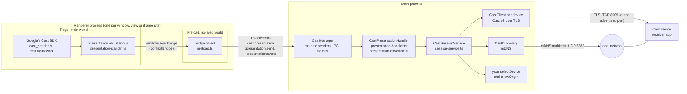
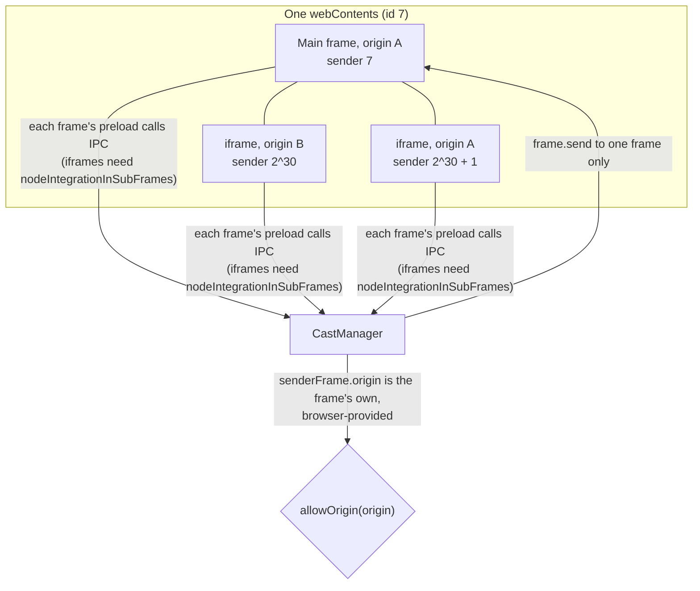
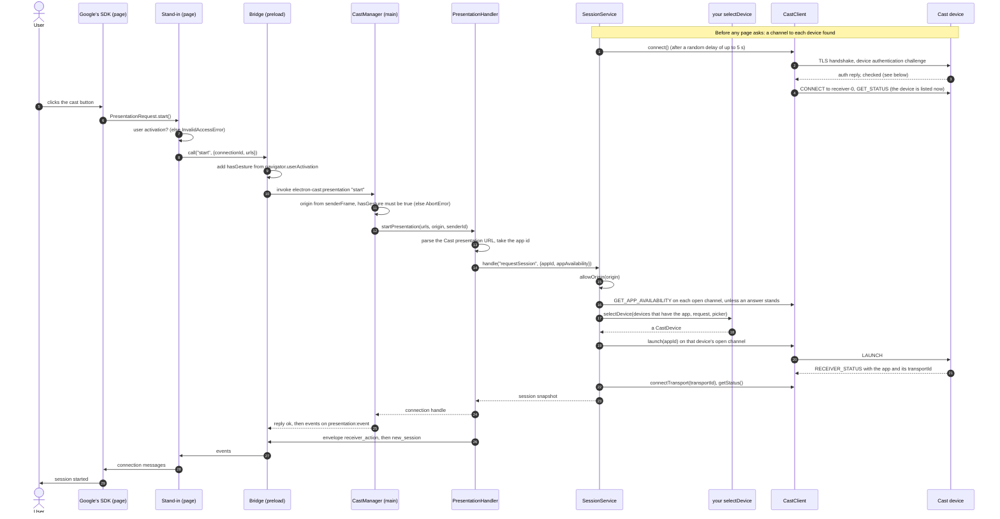
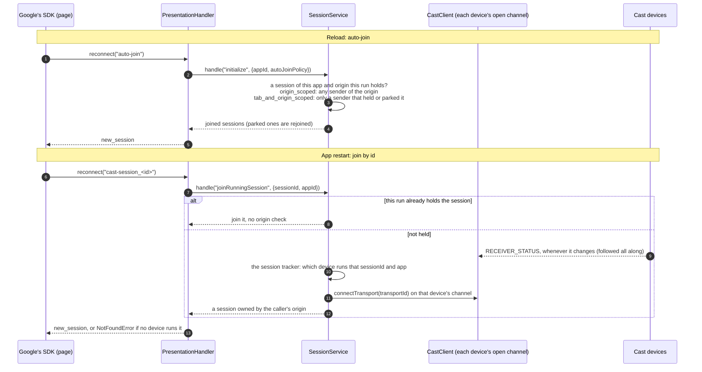
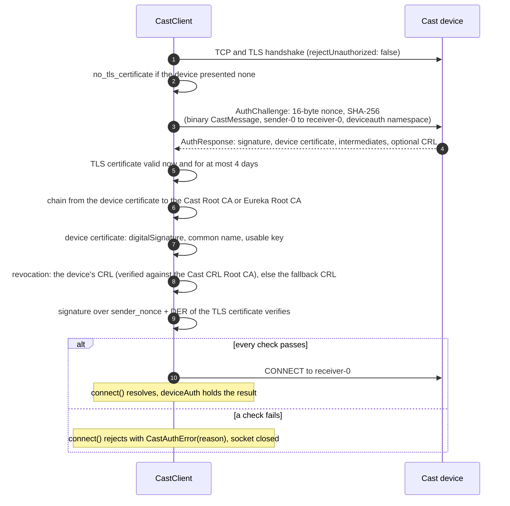

# Architecture

How electron-cast is laid out across processes and frames, how a cast starts, how a session is rejoined, how a device is
authenticated, and what the words mean. The diagrams render on GitHub.

For module-by-module behaviour and where it differs from Chromium, read [DESIGN.md](DESIGN.md). For which Chromium file each
module mirrors, read the [Chromium map](CHROMIUM-MAP.md).

## Process and frame layout

Reading it:

- **The page** runs Google's SDK unmodified. It finds `navigator.presentation`, and the stand-in answers. The stand-in knows
  nothing about Cast: it checks the user gesture as Blink does, allows one `start()` at a time, and moves strings over the
  bridge.
- **The preload** exposes the bridge and installs the stand-in with `contextBridge.executeInMainWorld`. In `start` calls it reads
  `navigator.userActivation.isActive` itself and sends that, replacing anything the page passed.
- **The main process** owns every secret and every socket: it decides which pages may cast (`allowOrigin`), which device was
  picked (`selectDevice`), and does discovery and the device channels, one kept open to each device as in Chrome. The page
  never sees a device's IP address or port.
- **The IPC channels** (`electron-cast:presentation` invoke, `:presentation:send` and `:presentation:event`; for
  `mode: "chromecast"` `electron-cast:call` and `:event`) are the only way across. What is validated on each is in
  [SECURITY.md](../SECURITY.md#what-crosses-the-ipc-boundary).
- **Nothing Electron is imported below `src/electron/`.** The manager and preload take Electron's objects as parameters, so the
  protocol, discovery, client and session service run and test in plain Node.

### Frames and senders

A **sender** is a frame. A main frame's sender id is its `webContents.id`; a subframe gets a synthetic id from 2^30 up, keyed by
`frameTreeNodeId` so it survives navigations. Watches, connections and sessions belong to a sender and events go only to it.
This mirrors Chromium's per-`RenderFrameHost` `PresentationServiceImpl`.

## What happens when a page starts a cast

Notes on the steps:

- Steps 1 to 4 happen once per device, not per cast (Chrome's `CastMediaSinkServiceImpl`), and again when a channel fails.
  A device that fails device authentication (step 3) rejects `connect()` with `CastAuthError` and is never listed, so it
  never reaches the picker.
- Step 7: the page-side refusal is a compatibility behaviour; the real check is the main process's (steps 9 and 11, and
  [SECURITY.md](../SECURITY.md#user-gesture)).
- Step 15: if `allowOrigin` returns false the request fails as "no receivers".
- Step 16: a device that does not have the app is not offered; if none has it, `start()` rejects with `NotFoundError`. The
  same answers serve the page's `getAvailability()` ([API](API.md#app-availability)).
- Steps 17 and 18: the time your picker is open does not count against the page's launch timeout.
- The envelope in the last steps is the JSON format Chrome's Media Router speaks to the SDK (see the glossary).
- App messages, media requests, volume and stop flow the other way through the same connection: the SDK sends an `app_message`
  or `v2_message` envelope, the handler maps it (for example to a `LOAD` on the media namespace to the app's transport) and the
  receiver's replies come back as envelopes.

## Reconnect and rejoin

`PresentationRequest.reconnect(id)` takes one of two ids, and the SDK sends both.

- **Auto-join** only finds sessions this run holds, as Chrome's `FindActivityForAutoJoin` skips activities that are not local.
- **A page reload** parks its sessions (`senderNavigated`): they stay open on the device, get no events, and the next page of
  the same frame rejoins them. `senderGone` (a destroyed webContents or removed frame) ends the sender's share for good.
- **Join by id** is answered from the session tracker, which follows every device's receiver status over its open channel,
  as Chrome's `CastSessionTracker` does; nothing is looked up when asked. The app supplies the id
  ([guide](guides/restart-rejoin.md)).

## Device authentication

Each failure maps to a `CastAuthError.reason` ([list](API.md#errors)). Verification runs when the channel opens, which the
sink service does for every device discovery finds, before the device is listed. Details, and the one deliberate difference from Chromium (a stale built-in CRL skips revocation rather than refusing):
[DESIGN.md](DESIGN.md#device-authentication-srcclientauth).

## Glossary

| Term | Meaning |
|---|---|
| **Sender** | In Cast, an app that casts to a device. In electron-cast, a **frame** with the preload: its own watches, connections and sessions. A page can also be said to be a sender in Google's docs; here the frame is the unit |
| **Receiver** | The Cast device, and the app running on it. "Receiver app" is the app (an app id such as `CC1AD845`); "the platform receiver" is the device's own endpoint, `receiver-0` |
| **Sink** | Chrome's Media Router word for a device you can cast to (`MediaSink`). Here a discovered `CastDevice`, seen through `registerMediaSinksObserver` |
| **Route** | Chrome's word for a running cast on a sink (`MediaRoute`). Here a Cast session; its id is the Cast session id. A route is **parked** when its pages navigated away and none is attached |
| **Presentation** | The W3C Presentation API: a `PresentationRequest` for a URL, whose `start()` or `reconnect()` gives a `PresentationConnection` (a message channel between page and receiver). Google's SDK uses a Cast URL such as `https://google.com/cast#__castAppId__=<appId>/...` |
| **Session** | The receiver app running on a device, identified by a `sessionId`. It outlives the page and the TLS connection |
| **Transport** | The receiver app's `transportId`: the destination id for messages to that app. A **virtual connection** (CONNECT and CLOSE on the connection namespace) to it must be open before messaging the app |
| **Namespace** | A message channel inside a Cast connection (`urn:x-cast:com.google.cast.media`, a custom app namespace, the platform's `receiver`, `heartbeat`, `connection` and `deviceauth`) |
| **Envelope** | The private JSON message format (`{type, message, sequenceNumber, timeoutMillis, clientId}`) that Google's SDK and Chrome's Media Router exchange over the `PresentationConnection`. electron-cast translates between it and the session service. Not a Cast v2 message; Cast v2 is the protobuf `CastMessage` to the device |
| **Auto-join** | The SDK rejoining a session on reload by `reconnect("auto-join")`, per its `autoJoinPolicy` |
| **Device authentication** | The `deviceauth` challenge that proves a device is Google-certified |
| **Picker** | Your `selectDevice` function: the UI that resolves the device a cast goes to |

## Layers and files

| Layer | Where | Depends on |
|---|---|---|
| Protocol | `src/protocol/`: `CastMessage`, framing, `DeviceAuthMessage` | Node only |
| Client | `src/client/`: `CastClient`, device authentication in `src/client/auth/` | protocol, `tls`, `crypto` |
| Discovery | `src/discovery/`: `CastDiscovery`, device cache, DNS codec | `dgram`, `os` |
| Session service | `src/electron/session-service.ts`, `manager-api.ts` | client, discovery types |
| Presentation | `src/electron/presentation-handler.ts`, `presentation-envelope.ts` | session service |
| Manager | `src/electron/main.ts` (`createCastManager`) | all of the above, Electron objects passed in |
| Preload and page | `src/electron/preload.ts`, `src/polyfill/` | page side only; no Node |
| Legacy polyfill | `src/polyfill/install.ts` (`mode: "chromecast"`) | frozen |
